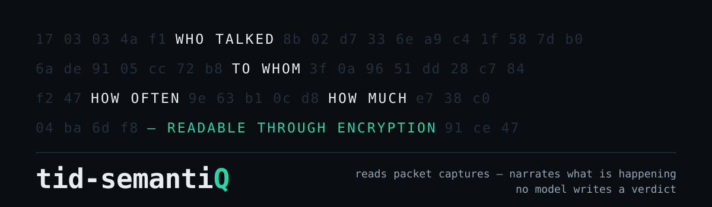

<p align="center">
  
</p>

# tid-semantiQ

[](https://github.com/TangoisdownHQ/tid-semantiQ/actions/workflows/ci.yml)

Reads a packet capture — encrypted or not — and narrates what is in it, with
the numbers behind every claim.

**Narration is the core, not the alerts.** Point it at a file and it tells you
what the capture contains: who talked to whom and under what names, what
happened in what order, what resolved and what did not, which channels were
regular or one-sided or unusually varied, and a per-endpoint and per-zone
dossier of every fact it holds. Rule violations are reported too, but a
capture that breaks no rules still gets a full account — "nothing matched my
rules" is not an interpretation of a capture.

Every sentence of that narration is assembled from measured values by ordinary
code. No model writes any of it, so it cannot drift from the numbers.

Not a decryption tool. It interprets behaviour and metadata: cadence, jitter,
volume asymmetry, cardinality, rarity. For your own traffic against an
authorized target you can supply TLS keys and it reads the plaintext too.

Standalone by design. `semantiq.py read foo.pcap` needs nothing but a Python
interpreter — no database, no dashboard, no service. Shipping findings into
a SOC collector or SIEM (`--out soc`) is one *output sink*, never a
dependency.

## Status

**v0.1, working end-to-end.** 622 tests pass.

- **Observation report** — the default output, and the point of the tool. A
  plain-language account of the capture, a timeline, conversations resolved to
  hostnames, per-protocol detail, a dossier per endpoint and per DNS zone, the
  ranked primitive measurements, and an explicit list of what could *not* be
  measured and why. It opens with a one-line **verdict** — "a host-side
  capture: one host reaching one destination over 36.9 min, mostly TCP/TLS;
  all of it encrypted (TLS 1.3)" — synthesised from the same measured values
  the sections below report, so the gist up top can never contradict the
  detail. Suppress with `--no-narrative`; widen with `--top N`.
- **Behavioural analysis** (`net`, `dns`) from metadata alone, no dependencies
  — cadence, jitter, volume asymmetry, cardinality, rarity, outcome failure
  rate.
- **Endpoint naming from DNS answers** — the answer section is parsed (A,
  AAAA, CNAME chains, TTLs, with compression pointers), so an address can be
  named without ever having spoken TLS. On a real capture this took naming
  coverage from 88 to 97 of 117 endpoints, and the addresses that remain
  unnamed are reported as such: reached without any lookup this capture saw.
- **Encrypted-traffic shape** — what is readable with no key at all. TLS
  record headers are cleartext, so record sizes and directions are
  measurable: a sender filling 16 kB records is moving bulk data, one
  emitting 48-byte records is sending individual messages. Combined with
  turn-taking and pacing, this separates a bulk transfer from a
  request/response fetch from an interactive session from a poller — on
  traffic the tool cannot read. Reported as a *shape*, never as an
  application identity, with the benign readings named alongside.
- **Per-host view** — one block per *originating* host: what it reached,
  what it spoke, what it looked up and whether that resolved, when it was
  active, the activity shapes its traffic took, and any requests it received
  that were addressed to somebody else. Every other dossier is keyed on the
  address that was reached, which cannot answer "what did this host do".
- **Exchange trace** (`--trace N`) — the busiest channels exchange by
  exchange: direction, size, inter-arrival gap. Aggregates hide whether
  5 MB in 1,300 exchanges was one download or 1,300 fetches; the sequence
  does not.
- **Server-side TLS** — the *negotiated* version (not the client's offer,
  read from `supported_versions` so TLS 1.3 is not misreported as 1.2), and
  the server certificate where the protocol permits: subject, issuer, validity
  window, SANs, self-signed, and whether it covers the requested SNI. The
  handshake is reassembled across TCP segments, because a chain is routinely
  2–4 kB against a ~1460-byte MSS. On TLS 1.3 the certificate is encrypted and
  the report says so — "unreadable by design" and "the server presented
  nothing" are different facts.
- **TCP connection outcomes** — established, closed, reset, *refused* and
  *never answered*, counted per destination. Tracked independently of
  application data, because a connection that failed carries none — which is
  why every payload-driven analysis was structurally blind to it.
- **Content analysis** (`http`) — JWTs, cookie flags and scope, credentials
  in URLs, CORS, secrets in response bodies, OAuth flow defects. Cleartext
  HTTP/1.x is parsed **natively, with no tshark and no keys**: messages are
  reassembled across TCP segments, keep-alive and chunked encoding are
  handled, and the observations carry the same attribute names as the tshark
  path so every inspector and rule works against either source unchanged.
  tshark is still needed for TLS-decrypted HTTP (`--http --keylog`) and for
  HTTP/2.
- **HTTP/2 request estimate** — how many requests a multiplexed HTTPS
  connection carried, inferred from outbound TLS record framing with no
  keys. HTTP/2 sends each request's HEADERS in a small outbound
  application-data record, so counting those (summed across the endpoint's
  connections, since an h2 client opens many) estimates the request count —
  enough to tell a ten-request fetch from a thousand-request scan through
  encryption. Offered only on h2 and labelled an estimate: control frames
  inflate it, TLS coalescing deflates it. (On a real engagement capture it
  put the exposure-scan phase at ≈270 requests across 54 connections and the
  light phase at ≈30.)
- **Encrypted-DNS (DoH/DoT) detection** — a host doing its lookups over DNS
  over HTTPS or TLS makes the report's DNS blind, so "no DNS seen" would be a
  lie by omission. The tool recognises a connection to a known public
  resolver (Cloudflare, Google, Quad9…) by its SNI or its resolver address on
  the DoH (443) / DoT (853) port, and says the resolution happened and is
  unreadable here — which is also a security signal, since malware moves its
  C2 lookups to DoH to defeat exactly this monitoring.
- **Cross-host correlation** — a credential sent to an unrelated host, user
  identifiers reaching third parties.
- **Session token quality** — predictability, fixed framing and decodable
  structure, measured across many samples. The one analysis a
  request-by-request tool structurally cannot do.
- **Response-time clustering** — a user-enumeration oracle, found without
  knowing which inputs were valid, with connection warm-up excluded.
- **Session fixation** — whether the session identifier survives
  authentication, plus session identifiers accepted from a URL.
- **Refresh-token rotation** — whether a stolen refresh token would keep
  working, graded by evidential strength: the server *returning* the same
  token is an inference, the server *accepting* it twice is an observation.
- **Endpoint and parameter inventory** with path templating.
- **Public Suffix List** for same-party decisions — `foo.co.uk` and
  `bar.co.uk` are different organisations, and two S3 buckets are different
  parties.
- **Modbus/TCP**, **DNP3** and **MAVLink** — unauthorised control commands
  from unestablished sources, protocol enumeration, device restarts,
  reporting suppression, drone command injection and GPS position integrity.
  Three more domains, and the test of the "a domain is cheap" claim.
- **Three input formats**: pcap/pcapng, pcap + TLS keylog, and **HAR** from
  Burp / mitmproxy / browser devtools — no capture or keys needed.
- **Live capture** (`semantiq.py live <iface>`) — capture from an interface
  and interpret it exactly as a file. The tool **never needs root**: dumpcap
  already holds `CAP_NET_RAW` and is written to be run privileged, so the
  privilege boundary is a pipe and everything here is ordinary user code.
  `LiveSource` subclasses the file reader and overrides only where frames
  come from, so every parser behaves identically live and from disk. The
  interface is always named by the operator — the tool will not guess one,
  because a loopback capture and a capture on a shared segment are different
  acts in law. Bound with `--duration` / `--frames`, or Ctrl-C, which stops
  the capture and reports what was seen rather than discarding it.
- **Wi-Fi / 802.11 captures** — a monitor-mode capture arrives as
  radiotap-wrapped 802.11 frames, not Ethernet; both are now decoded, so the
  IP traffic inside a data frame flows through the whole stack like any other
  capture. Honest about its limits: a WPA-protected data frame's payload is
  ciphertext with no readable structure — the Wi-Fi parallel to an encrypted
  TLS record — so on a protected network the meaning is in the metadata, not
  the payload. **Management-frame intelligence** reads exactly that: the
  beacons naming the access points and SSIDs in the air, the probe requests
  in which a device leaks the networks it has joined before (fingerprinting
  it), and deauthentication frames — a flood of which is the classic Wi-Fi
  denial-of-service and the opening of an evil-twin or handshake-capture
  attack, reported with the caveat that normal disconnects deauth too.
- **Streaming mode** (`--stream`) — sliding windows on an event-time clock,
  bounded memory, and an advisory when the window is too short to hold the
  cadences present.
- **eBPF flow tier** (`semantiq.py monitor`) — for a link too fast for
  per-packet capture: an eBPF/XDP program aggregates per flow in the kernel
  and emits one JSON record per burst, and `monitor` runs the same
  behavioural scorer on that trickle. A deliberately lower-fidelity tier —
  timing, volume, direction and ports (so cadence, asymmetry, fanout, rarity
  and beacon/exfil/scan still work), but no payload, so no content or
  TLS-shape analysis, and it says so. The kernel half is a documented,
  operator-compiled contract (`capture/bpf/`); a tshark bridge produces the
  same records so the path runs today without building anything.
- **TLS client reading** — which *library* a host's TLS handshakes are
  consistent with, from cleartext shape alone: GREASE presence (browsers
  send it, library stacks mostly don't), ALPN, and list lengths, read as a
  coarse hedged family — never a product name, never intent. Two distinct
  stacks from one host is itself called out: two pieces of software are
  originating TLS. The utls caveat prints with every reading.
- **Passive OS fingerprint** — a host states its operating system's
  defaults in the first packet of every TCP connection, in the clear: the
  TTL it starts from, the receive window, the MSS, and which TCP options it
  offers in what order. From the SYN alone the tool infers a coarse stack
  family (Linux/macOS/BSD · Windows · appliance) and the hop distance
  (rounding the arriving TTL up to the nearest 64/128/255) — shown with the
  numbers it rests on, never an exact version. Works on fully encrypted
  traffic, and a non-default MSS betrays a tunnel/VPN.
- **Cleartext service metadata** — protocols that state real facts without
  a key. SSH names its software in the identification banner before
  encrypting (both sides); NTP's header says who asked whom for time and
  from what stratum; DHCP carries the name a device calls *itself*, which
  now labels LAN addresses nothing ever resolves (at lower authority than
  DNS or SNI); mDNS/LLMNR are parsed as the DNS-format name gossip they
  are, on channels kept separate from resolver traffic.
- **QUIC / HTTP/3** — the long-header envelope (version, packet type) is
  read; everything else, including the SNI, is sealed from the first packet
  and reported as encrypted shape — the same "unreadable by design"
  honesty as a TLS 1.3 certificate. Short-header bulk stays counted as
  encrypted via per-connection memory of the proven handshake.
- **Capture artefacts** — honesty about the file itself: frames the IP
  header says were cut short (snaplen), byte-identical SPAN/bond
  duplicates (a real retransmit differs in its IP header), a clock running
  backwards, and silent gaps — each printed early, with what it corrupts,
  and only when present: silence means checked-and-clean.
- **Neighbour table (ARP / NDP)** — ARP replies and IPv6 neighbour
  advertisements are the LAN stating which IP is at which hardware address.
  ARP is not IP, so it was dropped before; parsed now, it gives an
  authoritative on-link IP↔MAC map that feeds device naming (stronger than
  a MAC inferred from an IP packet, and never confused with the gateway's).
  One IP resolving to several MACs is surfaced as the ARP-cache-poisoning /
  adversary-in-the-middle signal it is — with the innocent causes (DHCP
  reassignment, a replaced card, router redundancy) named, so it reads as
  something to confirm rather than a verdict.
- **Capture diff** (`semantiq.py diff before.pcap after.pcap`) — new
  originating hosts, new endpoints, no-longer-contacted endpoints, new DNS
  zones, new TLS client stacks, volume shifts (ratio *and* absolute floor
  both required), findings that appeared and findings no longer present
  (with the absence-of-evidence hedge). A literal two-file comparison,
  explicitly distinct from the rarity baseline, which is read but never
  written here.
- **Offline enrichment** (`--enrich-asn`, `--enrich-cloud`, `--enrich-oui`)
  — endpoints and devices attributed from datasets on disk: "announced by
  AS13335 CLOUDFLARENET (US)", "in AWS us-east-1, EC2 — the range's
  landlord, not necessarily who runs the endpoint", and for LAN hosts a
  device vendor from the source MAC's OUI ("Raspberry Pi Foundation").
  Consumes the common IP-to-ASN TSV, AWS/GCP/Azure range files
  (auto-detected), and a Wireshark `manuf` / IEEE OUI table. Offline on
  purpose: resolving an indicator against a live service tells the service
  what you are investigating. Each attribution has an honesty gate — ASN
  and cloud skip private space, MAC naming is confined to LAN hosts (a
  public source MAC is the gateway's) and declines randomised addresses.
  Nothing bundled; nothing degrades silently.
- **HTML report** (`--html report.html`) — the identical report text as
  one self-contained page: section navigation from the report's own rules,
  and the glossary inverted into hover tooltips — the first occurrence of
  each term is underlined, its short definition appears on hover, and a
  click lands on the full entry. No scripts, no remote resources, CSS-only
  tooltips; the page is as quiet as the analysis.
- **Techniques & weaknesses explained** — with `--glossary`, every ATT&CK
  technique, ATT&CK ICS technique and CWE weakness the findings cite is
  expanded in plain language beneath the findings, in citation order. The
  whole vocabulary the rules can emit is covered, and a completeness test
  walks the ontologies so a new rule citing an unexplained code fails the
  suite.
- **BPF capture filters** (`--bpf`) — a libpcap capture filter per finding
  (and a combined one), built from the flow's addresses and transport, to
  re-capture the flagged flows live: `dumpcap -f`, `tcpdump`, or `live
  --filter`. Distinct from the Wireshark display filter, which selects
  packets after capture by stream/frame index — a capture filter runs in the
  kernel and can only name what is on the wire, so it matches the flow, not
  the exact packets, and says so.
- **Wireshark plugin** (`wireshark/semantiq.lua` + `--wireshark-lua`) — the
  findings inside Wireshark itself, as a post-dissector: filter on
  `semantiq.severity`, add `semantiq.title` as a column, read each packet's
  verdicts in its protocol tree, and get a Tools-menu findings summary. The
  plugin holds no opinion — semantiQ writes an annotations file and the
  plugin only looks packets up in it by frame and stream, so it can never
  disagree with the report. See [wireshark/README.md](wireshark/README.md).
- **Glossary** (`--glossary`, also `--explain-terms`) — the report explaining
  its own vocabulary. The narration uses the words an operator uses —
  NXDOMAIN, SNI, asymmetry, a connection *refused* versus one *never
  answered* — and this appends an extensive plain-language definition for
  each technical term the report **actually used**, in the order it first
  appeared. It is contextual: a capture with no TLS prints no TLS entries,
  and a DNS flood prints the DNS vocabulary and little else. Like every other
  sentence in the report it is assembled by code, so a definition cannot
  drift from the term — which is what distinguishes it from the model-written
  `--explain` below. Definitions are labelled as definitions, not findings. It
  works in streaming mode too: a windowed run scans its findings report and
  cross-window summary, so the windowing vocabulary (sliding window,
  persistent vs TRANSIENT, load shedding) is explained where it appears. It
  also expands the **codes** a finding cites — every ATT&CK technique, ATT&CK
  ICS technique and CWE weakness the rules can emit has a plain-language
  description, printed for the codes the findings that fired actually carried.
  A completeness test walks the ontologies so a new rule citing an
  unexplained code fails the suite.
- **Model-assisted explanation** (`--explain`, optional, off by default) —
  plain-language explanations of findings and of the whole report. The model
  may only restate values the analyser computed: it names every measurement
  it relies on, each name is checked against the evidence ledger, and an
  explanation citing anything that was not measured is **discarded** rather
  than displayed. It cannot create a finding, change a confidence, or call
  anything malicious. Backends: local Ollama (default), any
  OpenAI-compatible endpoint, Hugging Face. Nothing in the analysis imports
  this package, so the measurements are identical with or without it.
- **Model-directed investigation** (`--investigate N`) — for the channels
  that scored highest *without* firing a rule, the model proposes one
  falsifiable hypothesis and names the measurements that would test it; this
  tool performs them and the model then judges its own hypothesis against the
  results. The measurement vocabulary is **closed**: the model selects a
  primitive by name from a fixed set and this tool constructs it, so nothing
  the model writes is ever executed. A hypothesis the numbers contradict is
  reported as such.
- Outputs: report, inventory, JSON, Wireshark colour filters and display
  filters.

No scoring weight has been fitted against real C2 yet — see
[Calibration](#calibration), and do not quote a detection rate from this.

## Run it

```bash
# analyse a capture (rarity needs history, so pass a baseline)
python3 semantiq.py read capture.pcap --baseline ~/.semantiq/home.db

# first build that history from traffic you believe is normal
python3 semantiq.py read a-week-of-normal.pcap --baseline ~/.semantiq/home.db

# findings + Wireshark colour rules + machine-readable output
python3 semantiq.py read capture.pcap --baseline b.db \
    --colorfilters ~/.config/wireshark/colorfilters --json findings.json

# findings INSIDE Wireshark: annotations for the bundled Lua plugin
python3 semantiq.py read capture.pcap --wireshark-lua capture.pcap.lua
SEMANTIQ_ANNOTATIONS=capture.pcap.lua wireshark capture.pcap   # then filter: semantiq

# BPF capture filters to re-capture the flagged flows live
python3 semantiq.py read capture.pcap --bpf flows.bpf
semantiq.py live eth0 --filter "$(grep -A1 '^# combined' flows.bpf | tail -1)"

# ship into the SOC
python3 semantiq.py read capture.pcap --baseline b.db --out soc \
    --soc-url https://soc.example/collector/logs --soc-key "$SOC_API_KEY"

# bug bounty: your own client, authorized target, TLS keys you own
SSLKEYLOGFILE=keys.log  chromium            # or curl, or any NSS-based client
python3 semantiq.py read capture.pcap --http --keylog keys.log

# or skip capture entirely — export a HAR from Burp / devtools
python3 semantiq.py read session.har

# industrial: learn normal polling, then judge against it
python3 semantiq.py read normal.pcap  --modbus --baseline ics.db
python3 semantiq.py read suspect.pcap --modbus --baseline ics.db

# define every technical term + ATT&CK/CWE code the report used — offline
python3 semantiq.py read capture.pcap --glossary

# the same report as one self-contained HTML page, terms explained on hover
python3 semantiq.py read capture.pcap --glossary --html report.html

# attribute endpoints + LAN devices from datasets on disk (nothing leaves the box)
python3 semantiq.py read capture.pcap \
    --enrich-asn ip2asn-combined.tsv.gz --enrich-cloud ip-ranges.json \
    --enrich-oui /usr/share/wireshark/manuf

# explain the findings in plain language, using a LOCAL model
python3 semantiq.py read capture.pcap --explain            # ollama/qwen-abl
python3 semantiq.py read capture.pcap --explain --explain-capture

# any OpenAI-compatible server: vLLM, llama.cpp, LM Studio, OpenAI
python3 semantiq.py read capture.pcap --explain \
    --llm-provider openai --llm-url http://127.0.0.1:8000/v1 \
    --llm-model llama-3.3-70b

# Hugging Face Inference Providers (needs HF_TOKEN)
python3 semantiq.py read capture.pcap --explain \
    --llm-provider huggingface --llm-model Qwen/Qwen2.5-7B-Instruct

# what changed between two captures: new hosts, endpoints, zones, findings
python3 semantiq.py diff yesterday.pcap today.pcap

# live capture on loopback, 30 seconds, then interpret it
python3 semantiq.py live lo --duration 30 --trace 3

# a long live session, reporting continuously from sliding windows
python3 semantiq.py live lo --stream --window 300 --emit-every 60

# per-exchange trace + activity shape, works on encrypted channels
python3 semantiq.py read capture.pcap --trace 5

# model-directed: hypothesise, measure, then judge the hypothesis
python3 semantiq.py read capture.pcap --investigate 3

# tests, and synthetic captures to try it on
for t in tests/test_*.py; do PYTHONPATH=. python3 "$t"; done   # 622 tests

# measure detection-per-jitter + false positives against the real scorer
python3 tools/calibrate.py
python3 tools/calibrate.py --sweep periodicity.dispersion_decay=2:5:1

python3 tools/make_test_pcap.py suspect.pcap --profile suspect
python3 tools/make_tls_pcap.py tls.pcap keys.log        # real TLS 1.3 + keylog
python3 tools/make_har.py session.har                   # + --tokens/--latency/--fixation
python3 tools/make_modbus_pcap.py m.pcap --profile scan  # + normal/write
```

No third-party Python dependencies. `core/` is stdlib-only on purpose, so
primitives stay portable if the capture loop ever moves to Rust. The
behavioural pass and cleartext HTTP need nothing at all; `tshark` is required
only to decrypt TLS (`--http --keylog`) or to read HTTP/2.

**Platforms.** File analysis and every output (`read`, `diff`, `monitor`,
and the `--json` / `--html` / `--bpf` / `--wireshark-lua` / colorfilters
sinks) are pure stdlib and run anywhere Python 3 does — Linux, macOS,
Windows. `live` capture works on all three: it shells to `dumpcap` (or
`tcpdump`), so on Windows install Wireshark — which provides `dumpcap.exe`
and the Npcap driver — and name the interface by its `dumpcap -D` index
(`semantiq.py live 1`). The eBPF `monitor` *producer* (`capture/bpf/flowmon`)
is Linux-kernel-only, but `monitor` itself just reads the JSON flow feed and
runs anywhere.

## What it looks like

The default output, on twenty minutes of ordinary browsing — addresses and
names anonymised to documentation values, the numbers real. Abridged — the
full report also carries a timeline, per-protocol tables, the ranked
measurements, and what could not be measured:

```
── WHAT THIS CAPTURE SHOWS ─────────────────────────────────────────────

  A single host, 10.20.0.7, originated every exchange in this
  capture, reaching 117 distinct addresses. This is a host-side
  capture, so nothing here describes traffic between other parties on
  the network.

  12% of exchanges (3,480 of 30,020) were encrypted. For those, this
  report describes timing, volume and direction only — the content was
  never available to it, and no claim here depends on having read it.

  90% of answered DNS lookups failed (11,859 of 13,197: NXDOMAIN
  11,859). Name resolution, not connectivity, is the dominant failure
  in this capture.

  7 of 638 TCP connections did not establish (3 refused, 4
  unanswered). Connections that did establish: 631.

  10,146 of 13,304 queries asked for names under 59 top-level domains
  that do not exist in the root zone (.a, .o, .e, .r, .t, .i, .n, .s).
  Those lookups could not have succeeded regardless of the network. A
  single name repeatedly re-queried under a series of short, invalid
  suffixes is the shape of a resolver appending a search-domain list
  to an unqualified name; it is also the shape of a generated-name
  lookup loop, and this capture alone does not separate the two.

── CONNECTIONS  (638 TCP flow(s)) ──────────────────────────────────────
      395  ( 61.9%)  completed and closed cleanly
      234  ( 36.7%)  established, then reset
        3  (  0.5%)  refused — reset without ever being answered
        4  (  0.6%)  never answered — no reply to the opening SYN

  never answered — no reply to the opening SYN, by destination:
        2 attempt(s)  203.0.113.84  ns1.dns-park.example
        2 attempt(s)  203.0.113.83  ns2.dns-park.example

── TIMELINE  (1.7 min per row) ─────────────────────────────────────────
  +  0.0 s                           16 exch     4.3 kB    2 peers    2 new
  +1.7 min  █                       182 exch   879.7 kB   10 peers    8 new
  +3.3 min  ███████████           2,845 exch     1.4 MB   26 peers   18 new
  +5.0 min  █████████████████     4,281 exch     2.1 MB   13 peers    3 new
  +6.6 min  ████████████████      3,923 exch     2.2 MB   26 peers   19 new
  +8.3 min  ████████████████████  5,041 exch     1.6 MB    5 peers

── ENDPOINT DETAIL  (top 2 of 117 by volume) ───────────────────────────

  198.51.100.84
    names        www.example.com  (1,321 exchanges)
    scope        public
    reached by   10.20.0.7 (1,327)
    transport    tcp/443 (1,321) · tcp/80 (6)
    volume       404.0 kB out, 5.4 MB in over 1,327 exchanges on 2 channels
    active       2026-01-12 14:02:51Z → 2026-01-12 14:11:49Z  (9.0 min)
    tls          3f9c21d8a0b47e65 (1,321)
    measured     asymmetry 0.84 · burstiness 0.17 · periodicity 0.08

  10.20.0.1
    reached by   10.20.0.7 (26,404)
    transport    udp (26,402) · udp/67 (2)
    volume       401.9 kB out, 1.3 MB in over 26,404 exchanges on 4,187 channels
    dns qtypes   A 16,686 · AAAA 9,600 · SRV 100 · CNAME 4 · MX 4 · NS 4
    dns zones    3,785 distinct; busiest example.com (3,640), example.a (1,688)
    dns outcome  1,338 of 13,197 resolved; NXDOMAIN 11,859
    measured     failure_rate.rcode 0.99 · periodicity 0.83 · burstiness 0.79

── DNS ZONE DETAIL  (top 1 of 3,785 by lookups) ────────────────────────

  example.a
    root zone    .a is not a delegated top-level domain — these lookups
                 could not resolve
    queried by   10.20.0.7 (1,688)
    resolver     10.20.0.1 (1,688)
    lookups      844 queries, 2 distinct name(s)
                     1,664  example.a
                        24  example.A
    qtypes       A 844 · AAAA 844
    outcome      0 of 844 answered lookups resolved (0.0%): NXDOMAIN 844
    measured     failure_rate.rcode 0.99 · periodicity 0.43
```

Note what the dossier does *not* do: `transport udp (26,402) · udp/67 (2)`
pairs each protocol with its own port instead of crossing the two, so the
resolver is not accused of 26,402 DHCP exchanges on the strength of two.

Findings print above the narration when a rule fires:

```
 ! [HIGH    ] Periodic outbound callback to an uncommon destination  (confidence 0.82)
    net.beacon.periodic_callback  2666a51c09ea
    10.0.0.5 -> 203.0.113.9   dport=443  proto=tcp  sni=cdn.example.net
    periodicity      period 54.2s  MAD 4.1s  40 callbacks
    jitter           ~30% jitter
    asymmetry        asymmetry +0.47  11123B out  4059B in
    rarity           0.0% of hosts  first seen 0s ago
    confidence       jitter=0.501 x 0.15 | periodicity=0.766 x 0.45 |
                     rarity=1.000 x 0.4 | weighted mean = 0.820 | final = 0.820
    refs             attack:T1071.001, attack:T1573
    wireshark        tcp.stream eq 16
```

Every number is computed. The confidence line is the arithmetic, printed, so
the verdict can be audited without trusting anything that generated prose.

## Three analyses

```
Primitive    one Series       "how does this channel behave?"
Inspector    one Observation  "what is wrong with this message?"
Correlator   all Series       "how do these channels relate?"
```

Three scopes a question can have, and there is no fourth. Behavioural
findings are statistics over time; most bug-bounty findings are facts about
one message; and the best ones exist only between channels — a bearer token
minted by one host and later sent to an analytics vendor is invisible to
anything looking at a single request.

All three land in one `Evidence`, so a rule can require a behavioural
threshold and a content fact in the same condition list, and the scorer still
computes every confidence.

Two capture backends, matching that split:

| | `capture/pcap.py` | `capture/tshark.py` | `capture/har.py` |
|---|---|---|---|
| needs | nothing | `tshark` on PATH | nothing |
| input | pcap/pcapng | pcap + TLS keylog | HAR export |
| sees | metadata: timing, volume, SNI, DNS | decrypted content, every Wireshark dissector | content, already plaintext |
| for | cadence, exfil shape, tunnelling | auth, cookies, tokens, inventory | same, with no capture step |

The HAR path exists for adoption, not capability: it runs on traffic people
already have, from the tools they already use. `test_har_and_pcap_agree`
asserts both paths produce the same rule set **and the same confidences** from
the same exchanges — which is the real check that the capture/analysis
boundary holds.

**Why tshark for content.** Pure-stdlib TLS 1.3 decryption is not feasible —
it needs the HKDF key schedule plus AES-GCM/ChaCha20-Poly1305 AEAD, and
`hashlib`/`hmac` provide no AEAD. Delegating means zero crypto written here,
and HTTP/1.1, HTTP/2, HTTP/3, WebSocket and gRPC arrive for free — as did
Modbus/TCP, which is now implemented. DNP3 and MAVLink/UDP are the same
shape.

```
capture/     pcap/pcapng -> Observation stream        (plugin per domain)
core/        9 primitives, inspectors, correlators -> Evidence  (stdlib)
ontology/    rules: evidence combinations -> Finding
out/         report | json | wireshark | soc
```

The contract is [docs/SPEC-observation.md](docs/SPEC-observation.md). Two
invariants hold it together:

1. **Primitives consume a `Series` and nothing else.** That is what lets a new
   domain reuse them unchanged — parsers share no code across domains, but
   the statistics share nearly all of it. Modbus/TCP was onboarded with no
   new primitive; cadence detection on a TLS callback is the same
   computation as on a Modbus scan cycle.
2. **The language model cannot write a verdict.** Confidence and severity are
   computed; `Finding` is frozen. The narrator produces prose, and any
   narrative citing a feature that was never computed is rejected
   mechanically rather than displayed.

## The thing that makes it usable

An exact-interval cron poller scores **1.000** on periodicity — identical to a
zero-jitter beacon. Periodic traffic is everywhere: update checkers, telemetry
agents, NTP, keepalives, CDN heartbeats. A tool that alerts on cadence alone
drowns the operator on day one.

So every beacon rule *requires* rarity. Measured on the synthetic fixtures:

| baseline | findings | prevalent 300s poller | jittered beacon | DNS tunnel |
|---|---|---|---|---|
| cold (no history) | **47** | fired (false positive) | fired | fired |
| warm (30 hosts) | **2** | suppressed | fired | fired |

Same capture, same thresholds. The only difference is history. Pinned by
`test_warm_baseline_suppresses_the_prevalent_poller`, which also asserts the
suppression comes from *prevalence* rather than from a thin-baseline or clock
artefact that happens to drive the score down.

Consequence worth internalising: **a cold baseline makes this tool
over-report, badly.** It says so at the top of every run rather than letting
the output look authoritative.

## Secrets

Once the inspectors work, a findings file would otherwise contain live
session cookies, bearer tokens and API keys — and that file gets attached to
bug reports. So everything leaving the process is masked by default, in the
terminal as well as on disk:

```
cookie.name     session
cookie.domain   .target-practice.test
cookie.flags    missing Secure, missing HttpOnly, missing SameSite
cookie.value    7f3a2b…5f6a (len 16, sha256:5fc2ce72)      <- masked
jwt.issues      alg=HS256 (symmetric; test RS/HS confusion); no exp claim
jwt.raw         eyJhbG…ZGVy (len 227, sha256:501ffab6)     <- masked
```

The analysis survives; the credential does not. Fingerprints keep masked
values comparable, so one token can be followed across hosts and requests
without ever being stored. Which fields are secret is **declared by the
inspector** rather than guessed from key names — guessing masked
`cookie.domain` and `jwt.issues`, which are the findings.

`--unsafe-show-secrets` disables it, prints a warning, and is named to be
uncomfortable to type.

## Honesty about statistics

Token quality is where a tool like this normally lies, so it is worth saying
how this one avoids it.

With n samples, any character position can show at most n distinct values, so
its *measured* entropy is capped at log2(n) bits however good the generator
is. Twelve samples can never measure more than 3.58 bits per position.
Reporting that total as "this token has 48 bits of entropy" would condemn a
perfectly good 128-bit token for the crime of being observed twelve times.

So scoring rests only on what few samples can **prove**:

| | |
|---|---|
| provable | a position that never varied across n samples |
| provable | values clustered in a vanishing fraction of the nominal keyspace |
| provable | a decoded token containing an identifier seen elsewhere |
| **not** provable | "the entropy of this generator is X bits" |

Measured entropy is still reported — labelled a lower bound, with the
measurement ceiling printed beside it.

Two false positives were caught by writing the negative tests first, and both
were this exact error:

- The bit-shortfall check compared the 64-bit target against
  `varying x log2(n)` — a quantity that shrinks with sample size. It
  condemned a genuine 64-bit token at n=8 and cleared it at n=16. Replaced
  with nominal keyspace capacity, which does not depend on how many times you
  looked.
- Timestamp detection fired on `secrets.token_hex(32)`. An arbitrary 8-hex
  window lands in the 2020-2033 epoch range ~9.8% of the time, and a 64-char
  token holds 57 such windows. Now requires the *same offset* in *every*
  sample, spanning under a day.

`test_strong_tokens_survive_every_sample_size_and_length` sweeps three token
lengths against three sample sizes to keep both fixed.

### The timing oracle, same discipline

Three more false positives were caught the same way:

- **`separation / within_spread` is not a bimodality test.** Splitting any
  unimodal sample in half roughly halves the within-half MAD, so the ratio is
  inflated by the act of splitting. Unimodal noise measured 2.9-8.8,
  overlapping real signal. Replaced by the size of the *void* between
  clusters — 1-8 on noise against 87-102 on a genuine 80ms split.
- **Gap alone fails on heavy-tailed latency.** Lognormal tails manufacture
  gaps; gap-only false-fired on 25.7% of samples at n=25, worsening with
  more data. Both gates are now required, measured at ~1% worst-case false
  positive against 98-100% detection.
- **Connection warm-up fabricates oracles.** Three TLS handshakes in a
  capture with no oracle produced a 0.88-confidence finding with a 387ms
  separation. First-on-connection responses are excluded, and the count of
  exclusions is reported.

The finding is capped at MEDIUM and says "NOT PROVEN", naming replay as the
confirmation step — tight statistics can still describe caching or backend
load.

### Heuristic boundaries are reported, not hidden

Session fixation needs to know that authentication happened, which is a
guess. Comparing two cookie values is trivial; a wrong boundary produces a
confident finding about nothing. So the signal that identified it travels with
the finding —

```
auth_signal   path /login + password field in request body
auth_status   200
note          boundary detection is heuristic — confirm the request
              above really authenticated
```

— and a login that did not clearly **succeed** is never used as a boundary. A
401 rotates nothing, so treating it as one would report fixation on every
application that correctly rejects a bad password.

## Streaming

`group_into_series` buffers a whole capture. That is right for a file and
wrong for a live link, so `--stream` runs the same analysis over sliding
windows:

```bash
python3 semantiq.py read capture.pcap --baseline b.db --stream \
    --window 1200 --emit-every 300
```

**Event time, not wall-clock.** Emission is driven by timestamps in the
stream. That makes replaying a file through the windower produce exactly what
a live run would, which is the only way to test it —
`test_streaming_matches_batch_when_the_window_fits` asserts batch and
streaming reach the same findings.

**Windows slide, they do not tumble.** A channel is re-emitted each window
carrying its last `--window` seconds, so evidence accumulates and confidence
rises. The repetition is collapsed by `Finding.id`, keeping the
best-evidenced instance, and the output reports how each finding behaved:

```
across 30 windows:
  dns.tunnel.high_cardinality_zone   4/30 windows  persistent confidence rose
  net.beacon.periodic_callback       3/30 windows  persistent confidence rose
```

A finding seen in one window out of thirty is flagged **TRANSIENT** — it may
be an artefact of where the boundary fell, and the operator is the one who
can tell.

**The window has to fit the cadence.** This was found by running it:
`Periodicity` needs six observations, so a 54-second beacon needs about 324
seconds of window. At `--window 300` the beacon was simply **absent** —
found in batch, missed in streaming, with nothing in the output to say why.
That is now computed and reported:

```
ADVICE  --window 300s is too short for the slowest cadence observed: a
        channel averaging 147.5s between observations needs about 885s to
        show 6 of them. Periodicity findings on such channels are not weak
        — they are absent.
```

**Load shedding is never silent.** Channel and per-channel caps bound
memory; both are counted and surfaced, because a quiet result off a flooded
link needs to say the tool was dropping traffic.

**The baseline is not written in streaming mode.** A sliding window re-emits
the same observations, so recording each emission would multiply a channel's
history by the windows it survived and make prevalence meaningless. Warm the
baseline with a batch pass.

## Calibration

Weights in `core/primitives/` are reasoned, not fitted. No number in this
repo is a field detection rate. Two tools turn that honesty into something
you can measure.

**`tools/calibrate.py`** — a detection-rate-per-jitter curve against
*synthetic* traffic driven through the real scorer. It synthesises a beacon
at a controlled jitter level to a destination the baseline has never seen,
plus benign background (exact-interval pollers and browsing to a few
destinations every host contacts, so those are prevalent and should be
suppressed), and reports detection per 0 / 20 / 50 / 90% jitter alongside the
benign false-positive count:

```
  jitter   detection
     0%    100%  ████████████████████████
    20%     93%  ██████████████████████
    50%     37%  █████████
    90%      7%  ██

  false positives (benign background): 0  = 0.00 per host per hour
```

`--sweep periodicity.dispersion_decay=2:5:1` re-runs the whole measurement
across a tunable range — the refit loop, without a patch. It is explicit in
its own output that a number here is a property of the scorer against *this
model*: the jitter is uniform where a real implant's may be patterned, and
the background is modelled, not captured.

**`tools/measure_false_positives.py`** — the other half, on a *real* capture:
split it, warm the baseline on the first part, judge the second, and report
false positives per host per hour with an assessability table so a zero is
read as "measured" rather than "nothing fired".

Getting field numbers still means Sliver or Havoc in a lab and a week of
genuine traffic — but the loop that consumes them (measure → move a threshold
→ measure again) now exists and is tested. Thresholds are overridable without
a patch: `--set periodicity.dispersion_decay=4.0`.

## Roadmap

**Done.** Network (TCP/TLS) and DNS behavioural analysis. The tshark backend
with keylog-assisted decryption. HAR import. Seven inspectors with redaction
(JWT, cookies, token-in-URL, CORS, secrets-in-response, OAuth, disclosure).
Four correlators (cross-host credential leakage, identifier spray, session
token quality, session fixation). Response-time clustering. Endpoint and
parameter inventory. Public Suffix List for same-party decisions.

**Next.** Attaching the streaming path to a live interface. The windower
is done and tested by replaying files through it, which is equivalent
because it runs on event time — but nothing here has been pointed at a NIC,
and that step needs capture privileges and an explicit decision about what
the tool is allowed to listen to.

**Then cheap hardware:** Wi-Fi (~$20), BLE and CAN (~$20 each). CAN and BLE
will follow the MAVLink pattern — native parsers, since Wireshark needs a
capture format it will not get from a USB dongle. SDR is the one real cliff:
different mathematics, real budget. SpaceWire and live satellite links are
gated on hardware access.

### What onboarding a domain actually cost

Three domains in, the claim holds: **no new primitive for any of them**, no
contract change, and a few small classifier inspectors each. The HTTP
latency analyzer transferred to Modbus unchanged, because Wireshark supplies
`modbus.response_time` and the primitive takes its attribute names as
parameters.

But "a domain is a tshark field list" was only two-thirds true:

| domain | how | why |
|---|---|---|
| Modbus/TCP | tshark profile | 76 dissector fields |
| DNP3 | tshark profile | 207 fields; link-layer CRCs that Wireshark validates for us |
| MAVLink | **native parser** | Wireshark ships **no** MAVLink dissector — the one that exists is a Lua plugin generated from the MAVLink XML |

So MAVLink ended up demonstrating the other half of the capture contract:
a domain can be a native parser, and nothing above `capture/` can tell which
it got. `test_native_parser_needs_no_tshark` asserts that directly.

Modbus was the first test of the claim, and the one that exposed the most.
Everything learned across the five is written up as a checklist in
[the spec](docs/SPEC-observation.md#the-onboarding-checklist) — nine items,
every one a mistake actually made, several of them twice. They share a shape:
each produces plausible output rather than an error, so none announces
itself.

What it did **not** survive was calibration. Three defaults tuned for web
traffic were wrong on a control network, each producing silence or nonsense
rather than an error:

- **Periodicity measured the wrong thing.** A master polling two function
  codes 50ms apart on a 1s cycle gives intervals of 0.05, 0.95, 0.05,
  0.95 — bimodal. The steady master scored **0.001** and a flat-rate
  scanner scored **1.000**, exactly backwards. Fixed by adding an optional
  `group_attr`, so each function code's cadence is measured separately;
  the master now scores 0.990 at a true 1.000s period.
- **Fanout counted both directions.** Modbus responses echo the unit id, so
  a 24-unit sweep looked like 24 unique values over 80 messages instead of
  over 40 requests. Added a `kind` filter and a domain-sized `saturation` —
  50 distinct DNS names is unremarkable, 50 Modbus unit ids is an
  exhaustive sweep.
- **Rarity could not see a new source.** It scored 0.40 for the established
  master and 0.40 for the rogue. `prevalence` drops the initiator by design,
  so on a one-master network "something talks to this PLC" is 100%
  prevalent; `recency` spans days, so both read as recent inside one
  capture. Added a `novel` feature — zero prior observations — which is the
  signal the ICS rules actually gate on.

Two parsing bugs, both caught by the fixtures: Wireshark does not set
`modbus.request_frame` on **exception** responses, so a request/response
test based on it classified all 36 exceptions as requests and invented a
channel where the PLC appeared to command the scanner; and the modbus stack
shipped `SequenceOrder(allowed=frozenset())`, which permits nothing and so
scored every transition on valid traffic as a violation — inert only because
no rule referenced it.

**Not building:** a proxy, a repeater, an intruder, a scanner.

## Legal

Capture only traffic on networks you administer, or your own traffic to an
authorized target. Those two cases cover defensive monitoring and bug bounty
and are the only intended uses.

Monitor-mode Wi-Fi and RF capture reach third-party communications and are
governed by different law — intercepting encrypted, cellular or satellite
transmissions is prohibited outright in the US, and the rules vary by
jurisdiction. Neither has a plugin here yet; when they land they will default
to operator-owned identifiers and require an explicit flag to go broad.

## Licence

**Apache-2.0** — see [LICENSE](LICENSE).

Open because this tool extracts credentials. It pulls JWTs, session cookies
and API keys out of traffic, and nobody should run a closed binary over a
capture holding their client's session tokens. The claim that makes it worth
using — every confidence is printed arithmetic and no model writes a verdict
— is a claim you can only check by reading the source.

AGPL-3.0 would be the alternative if stopping someone reselling this as a
hosted service mattered more than adoption. It is a one-file change.

### Third-party

Going open did **not** unlock the two components worth naming. If anything it
settled them the other way:

- **RITA is GPLv3.** Apache-2.0 cannot absorb GPL code — the result would
  have to be GPL. The beacon scoring here stays a reimplementation from
  RITA's published method, with no code borrowed.
- **JA4 proper is under the FoxIO License 1.1**, which restricts commercial
  use; Apache-2.0 explicitly permits it. Vendoring JA4 would hand downstream
  users a licence promising more than the embedded component allows, so
  `capture/decode.py` keeps computing its own ClientHello hash. The sibling
  fingerprints (JA4S/H/X) are BSD-3 and would be fine; verify current terms
  before relying on that.
- **`data/public_suffix_list.dat` is MPL-2.0**, vendored unmodified with its
  header intact. File-level copyleft, so it stays MPL and the Apache code
  around it is unaffected.

A TLS fingerprint identifies the *library*, not intent — anything using
`utls` mimics Chrome exactly. It is a rarity feature joined to other evidence,
never a verdict, which is why it has no primitive of its own.
